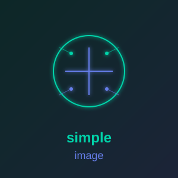

<p align="center">
  
</p>

# simple_image

**[Documentation](https://simple-eiffel.github.io/simple_image/)** | **[GitHub](https://github.com/simple-eiffel/simple_image)**

Image editing in Eiffel: load, filter, mask, compose, save. Built to make video thumbnails and
reel covers without Python.

- **IMG_IMAGE**: straight (non-premultiplied) RGBA, 8 bits per channel, in C memory.
  Blur, Lanczos-3 resize, crop, brightness, contrast, colour, vignette, flatten, alpha.
- **IMG_MASK**: one 8-bit channel. Blur, grow, shrink, threshold, invert, flood fill,
  keep the largest piece, resize, crop.
- **IMG_CANVAS**: drawing on simple_cairo: place layers, paint a colour through a mask
  (glows, halos, shadows), and text and shapes through `context` (outlined text with
  `text_path`). A mask canvas turns whatever is drawn into a mask.
- **SIMPLE_IMAGE**: facade: `load`, `load_mask`, `new_image`, `new_mask`, `new_canvas`,
  `new_mask_canvas`, `canvas_from`.

Files go through simple_stb (PNG, JPEG, BMP, TGA, GIF, PSD, HDR in; PNG and JPEG out).
The AI helpers (person cutout) are in **simple_image_ai**.

## Example: an outlined title with a soft shadow

```eiffel
images: SIMPLE_IMAGE
create images.make
background := images.load ("frame.png")           -- detachable: check it
background.enhance_brightness (0.5)
background.vignette (0.6)

shadow_canvas := images.new_mask_canvas (background.width, background.height)
shadow_canvas.context.select_font ("Impact", shadow_canvas.context.Slant_normal, shadow_canvas.context.Weight_normal)
	.set_font_size (130).move_to (60, 660).text_path ("TITLE").fill.do_nothing
shadow := shadow_canvas.to_mask
shadow.grow (3)
shadow.blur (6)

canvas := images.canvas_from (background)
canvas.fill_through (shadow, 0xC0000000, 6, 6)
canvas.context.select_font ("Impact", ...).set_font_size (130).move_to (60, 660).text_path ("TITLE").do_nothing
canvas.context.set_color_rgb (0, 0, 0).set_line_width (14).set_line_join (canvas.context.Join_round)
	.stroke_preserve.set_color_rgb (1, 0.83, 0.3).fill.do_nothing
result := canvas.to_image
if result.save_jpg ("thumbnail.jpg", 92) then ... end
```

## Design (decided by measurement, 2026-10-11)

The design came from an `/eiffel.debate` cycle, recorded in `.eiffel-workflow/debate/`:

| Decision | Evidence |
|---|---|
| Pixels stay straight RGBA in C memory, not in a cairo surface | Premultiplied 8-bit storage loses a mean of 30 levels of colour at alpha 1-10 |
| Every kernel that mixes soft-alpha pixels premultiplies in float inside the loop | A straight blur turns a red edge dark (R 90 instead of 255) |
| Glows and shadows are a mask plus a colour fill | Within 0.2 levels of a float premultiplied blur |
| Per-pixel loops in C, contracts on the Eiffel features | Eiffel loops with contracts on ran 3.6-4.4 times slower |
| Our own Lanczos-3, not cairo's scaler | cairo's best filter is off by up to 61 levels on mask edges; ours by 4 against PIL |

Colours are `NATURAL_32` words `0xAARRGGBB` with straight alpha. Paths must be plain ASCII
(simple_stb opens files with `fopen`).

## Tests

```bash
/d/prod/ec.sh test -config simple_image.ecf -target simple_image_tests
PATH="/d/prod/simple_cairo:$PATH" ./EIFGENs/simple_image_tests/F_code/simple_image.exe   # from the library root
```

27 tests. They write to `data/output/`. The soft-edge tests were checked by breaking the kernel
rule on purpose: a straight-colour blur and resize fail them.

## Dependencies

simple_stb (1.1.0 or later: images free themselves; the stb implementation is static so
clients link), simple_cairo (1.4.0 or later: `text_path`), EiffelBase.
